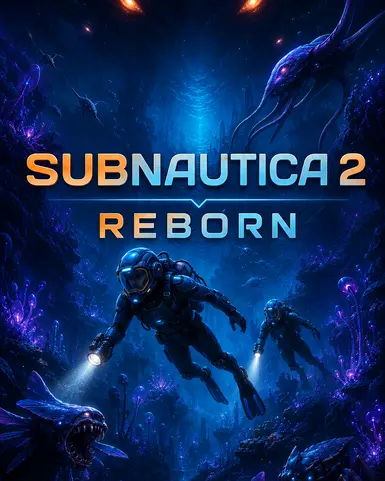

# CHANGELOG // LIVE FEED

> `> SUBSCRIBING TO #changelog-feed...`
> `> AUTO-SYNC: ENABLED`
> `> SOURCE: DISCORD BOT`

This page tracks the current revision of every collection we track. Each
collection's card below always reflects its own **latest** revision — an
update to one collection only replaces that collection's card, the others
stay exactly as they are. Older revisions roll off into the
[Archive](archive.md) as soon as that specific collection updates again.

!!! info "How this page updates"
    Entries are generated from [`template.md`](template.md), which the bot
    fills in and posts here whenever a tracked collection ships a new
    revision. Nothing on this page should be hand-edited except by the bot
    or a staff member performing a manual sync.

!!! tip "Always check this first"
    Before downloading a collection in [Installation](../installation/index.md),
    confirm your game version matches the one shown on its card below.

---

<!-- CHANGELOG:CURRENT:START -->

Preem Edition

<!-- CHANGELOG:CURRENT:ENTRY:buqwx3:START -->
<button type="button" class="pt-changelog-card" data-pt-changelog-open="changelog-current-buqwx3">

Preem Edition-12
2026-10-18 · CP2077 2.31a
Added
Updated
Removed

</button>

<dialog class="pt-changelog-modal" id="changelog-current-buqwx3" markdown="1">

<button type="button" class="pt-changelog-modal-close" data-pt-changelog-close aria-label="Close changelog">×</button>

## Preem Edition-12

Added
Updated
Removed

`2026-10-18` · Game Version `2.31a` · Posted by **Choomba** · Synced from `#CPE`

### Added {: .pt-changelog-h-added }

- [Always play Metro Card Animation](https://www.nexusmods.com/cyberpunk2077/mods/35305) (v1)
- [Audible Traffic Radios](https://www.nexusmods.com/cyberpunk2077/mods/34896) (v1.0.0)
- [Avelyne - Hair CCXL](https://www.nexusmods.com/cyberpunk2077/mods/35256) (v1)
- [Breathing FX](https://www.nexusmods.com/cyberpunk2077/mods/34468) (v1.3)
- [CC Cyberpunk. Enhanced Morph. Nails Pack](https://www.nexusmods.com/cyberpunk2077/mods/34868) (v1.1)
- [Crowd Props Restored](https://www.nexusmods.com/cyberpunk2077/mods/35285) (v1.0.1)
- [Crowd Seat Overlap - Duplication Fix](https://www.nexusmods.com/cyberpunk2077/mods/34735) (v1.1.3)
- [Crowd Umbrellas Restored](https://www.nexusmods.com/cyberpunk2077/mods/35264) (v1.0.1)
- [Crowd Variety Restored](https://www.nexusmods.com/cyberpunk2077/mods/34908) (v1.0.3)
- [Crowd Walks Restored](https://www.nexusmods.com/cyberpunk2077/mods/34789) (v1.0.1)
- [DEADLINK_Atelier Store](https://www.nexusmods.com/cyberpunk2077/mods/27589) (v11)
- [DEADLINK_Layered Shirts AXL](https://www.nexusmods.com/cyberpunk2077/mods/35324) (v1)
- [Dedra Core](https://www.nexusmods.com/cyberpunk2077/mods/34882) (v1.9)
- [Dusk's Store - Virtual Atelier](https://www.nexusmods.com/cyberpunk2077/mods/34228) (v2)
- [General Vehicles Fixes](https://www.nexusmods.com/cyberpunk2077/mods/31813) (v3.03)
- [Gris-Gris Decal Fix](https://www.nexusmods.com/cyberpunk2077/mods/34866) (v1.0.1)
- [Happy Kids](https://www.nexusmods.com/cyberpunk2077/mods/34718) (v1.0.0)
- [High Messy Bun - Hair CCXL](https://www.nexusmods.com/cyberpunk2077/mods/35111) (v1)
- [Honda 04](https://www.nexusmods.com/cyberpunk2077/mods/34870) (v3)
- [Hopping In - Pedantic Correction](https://www.nexusmods.com/cyberpunk2077/mods/35325) (v1.0)
- [Melee Weapon Pack 3](https://www.nexusmods.com/cyberpunk2077/mods/35118) (v1.0)
- [Netrunner Suit Pt10](https://www.nexusmods.com/cyberpunk2077/mods/34499) (v1)
- [Photomode UI Improvements](https://www.nexusmods.com/cyberpunk2077/mods/34353) (v1.3.1)
- [RedFileSystem](https://www.nexusmods.com/cyberpunk2077/mods/13378) (v0.15.1)
- [Rogue's Cybernetic Eyes for V CCXL and Glow - Both Vs](https://www.nexusmods.com/cyberpunk2077/mods/34874) (v1)
- [RTRay Tracing PTPath Tracing Contact Shadow FIX](https://www.nexusmods.com/cyberpunk2077/mods/35156) (v1.0)
- [Scan Through Glass Windows](https://www.nexusmods.com/cyberpunk2077/mods/35318) (v1.0.1)
- [Shotgun Shell Eject Fix](https://www.nexusmods.com/cyberpunk2077/mods/35058) (v1.0.0)
- [Snug Lounge Set - AXL](https://www.nexusmods.com/cyberpunk2077/mods/34229) (v1)
- [Top Knot Full Bangs - Hair CCXL](https://www.nexusmods.com/cyberpunk2077/mods/35110) (v1)
- [Traffic Radio Fix](https://www.nexusmods.com/cyberpunk2077/mods/34659) (v1.0.0)
- [UNIVERSAL SKIN TONE - Remaster - Ultra Realistic Skin Textures - Complexion - VTK x KSUV - Any Body - FemV](https://www.nexusmods.com/cyberpunk2077/mods/32693) (v1)
- [Vehicle Destruction Mesh Fix](https://www.nexusmods.com/cyberpunk2077/mods/35121) (v1.1)
- [Viktor Complete Cyberware Inventory Fix](https://www.nexusmods.com/cyberpunk2077/mods/34676) (v1.0.0)

### Updated

- [Adaptive Sliders](https://www.nexusmods.com/cyberpunk2077/mods/5075) (v20260912 → v20261018)
- [Always First Equip](https://www.nexusmods.com/cyberpunk2077/mods/2557) (v2.1.6 → v2.1.7)
- [Anti-Theft Measures](https://www.nexusmods.com/cyberpunk2077/mods/27229) (v2.2.1 → v2.3)
- [ArchiveXL](https://www.nexusmods.com/cyberpunk2077/mods/4198) (v1.27.3 → v1.27.4)
- [AudioXL](https://www.nexusmods.com/cyberpunk2077/mods/33442) (v0.5.1 → v0.8.1)
- [Axellysse Virtual Atelier 2](https://www.nexusmods.com/cyberpunk2077/mods/28924) (v18 → v20)
- [Blue Moon Romanced Quest](https://www.nexusmods.com/cyberpunk2077/mods/32733) (v2.0 → v3.0)
- [Community Hair Pack](https://www.nexusmods.com/cyberpunk2077/mods/28483) (v1.07 → v1.08)
- [DigitalVixen Core](https://www.nexusmods.com/cyberpunk2077/mods/28390) (v4.9.3 → v4.9.5)
- [Dusty Virtual Atelier](https://www.nexusmods.com/cyberpunk2077/mods/14797) (v74 → v75)
- [Eren's Shop](https://www.nexusmods.com/cyberpunk2077/mods/8505) (vv1.0 → vv1.1)
- [Fluff Vendor Fixes](https://www.nexusmods.com/cyberpunk2077/mods/27795) (v1.1.1 → v1.1.2)
- [FX Begone Customized Effects Removal](https://www.nexusmods.com/cyberpunk2077/mods/9209) (v1.1.0a → v2.2.0)
- [HeRa 2 - Atelier Store](https://www.nexusmods.com/cyberpunk2077/mods/28710) (v14 → v15)
- [Immersion Extension - Reed's Train Ambush - Echoes of the Past](https://www.nexusmods.com/cyberpunk2077/mods/34502) (v1.0.0 → v1.1.0)
- [Immersion Patch - Cyberpunk Story Quest Fixes](https://www.nexusmods.com/cyberpunk2077/mods/29152) (v1.18.0 → v1.20.0)
- [Immersive Explosions](https://www.nexusmods.com/cyberpunk2077/mods/31624) (v1.1.2a → v1.1.4)
- [Immersive Third Person - Best Of Both Worlds](https://www.nexusmods.com/cyberpunk2077/mods/32203) (v1.3.0 → v2.0.0)
- [KMKC's - Virtual Atelier](https://www.nexusmods.com/cyberpunk2077/mods/16065) (v6.6 → v7)
- [Kriostech Sportswear Modular - Archive XL](https://www.nexusmods.com/cyberpunk2077/mods/26039) (v1.2 → v1.3)
- [Lamborghini Miura P400 SV Garage](https://www.nexusmods.com/cyberpunk2077/mods/13508) (v0.9.8.5 → v2.0.1)
- [Loot Icons Extension](https://www.nexusmods.com/cyberpunk2077/mods/16386) (v1.53 → v1.58)
- [LUT Switcher 3 Realtime - Scanner - Weather - Menu](https://www.nexusmods.com/cyberpunk2077/mods/16310) (v3.3.0 → v3.4.0)
- [Map Waypoint Bug Fixes](https://www.nexusmods.com/cyberpunk2077/mods/32175) (v1.0.0 → v1.1.0)
- [MELUMINARY x VEILGARDENS VIRTUAL ATELIER](https://www.nexusmods.com/cyberpunk2077/mods/26511) (v30 → v31)
- [Military Armor-Plated Pants and Pouches - Archive XL](https://www.nexusmods.com/cyberpunk2077/mods/23912) (v1.0 → v1.1)
- [Much Better AI](https://www.nexusmods.com/cyberpunk2077/mods/31402) (v2.15 → v2.2)
- [NC Fashion Virtual Atelier](https://www.nexusmods.com/cyberpunk2077/mods/4805) (v10.1.h → v10.1.j)
- [NightlyNow Core](https://www.nexusmods.com/cyberpunk2077/mods/28966) (v1.1.8 → v1.2)
- [Nola Dreamer Virtual Boutique](https://www.nexusmods.com/cyberpunk2077/mods/5114) (v7.5 → v7.6)
- [Panam Conversations Addon](https://www.nexusmods.com/cyberpunk2077/mods/32507) (v1.1.1 → v1.1.2)
- [Radial Menu Upgrade for Idle-Computer-TV Anywhere mods](https://www.nexusmods.com/cyberpunk2077/mods/26764) (v1.2.0 → v1.3.0)
- [Raetelier 4 - Raenef's Atelier](https://www.nexusmods.com/cyberpunk2077/mods/28870) (v1.2 → v1.3)
- [RedFunctions](https://www.nexusmods.com/cyberpunk2077/mods/32312) (v0.13.0 → v0.14.0)
- [Redscript Configuration Framework](https://www.nexusmods.com/cyberpunk2077/mods/30726) (v3.0.1 → v3.1.0)
- [Sabbath7991 Weapon and Attachment Shops - Virtual Atelier](https://www.nexusmods.com/cyberpunk2077/mods/18757) (v1.83 → v1.86)
- [Say Something Damn It](https://www.nexusmods.com/cyberpunk2077/mods/22228) (v1.16.0 → v1.16.1)
- [SDH0's Vehicle Resources](https://www.nexusmods.com/cyberpunk2077/mods/20956) (v2.0.0 → v2.0.1)
- [The Fifth Element Collection M-F GS AXL](https://www.nexusmods.com/cyberpunk2077/mods/27709) (v1.0.0 → v1.1.0)
- [The RVC00N Dumpster 3 - PinkyDude's Virtual Atelier](https://www.nexusmods.com/cyberpunk2077/mods/25981) (v16.0.0 → v17.0.0)
- [Tony's Adult Store 2 Virtual Atelier](https://www.nexusmods.com/cyberpunk2077/mods/28555) (v3.8 → v4.0)
- [Veegee Shop 4](https://www.nexusmods.com/cyberpunk2077/mods/30021) (v1.0.9 → v1.1.0)

### Removed {: .pt-changelog-h-removed }

- [Arasaka JSH-X12 Nobunaga](https://www.nexusmods.com/cyberpunk2077/mods/24033) (v1.4)
- [Realistic Complexion - III - for Universal Skin Tone - Head Textures - Face Details - 4K - 8K](https://www.nexusmods.com/cyberpunk2077/mods/19314) (v1)
- [UNIVERSAL SKIN TONE - Realistic Textures - Complexion - 72 skin tone - VTK KSUV - Any Body](https://www.nexusmods.com/cyberpunk2077/mods/15426) (v3.0)
- [Vehicle Handling Redux](https://www.nexusmods.com/cyberpunk2077/mods/33749) (v2.1)

</dialog>
<!-- CHANGELOG:CURRENT:ENTRY:buqwx3:END -->

Subnautica 2 Reborn

<!-- CHANGELOG:CURRENT:ENTRY:9htmlb:START -->
<button type="button" class="pt-changelog-card" data-pt-changelog-open="changelog-current-9htmlb">

Subnautica 2 Reborn-11
2026-09-20 · CP2077 Early Access 1.2
Removed

</button>

<dialog class="pt-changelog-modal" id="changelog-current-9htmlb" markdown="1">

<button type="button" class="pt-changelog-modal-close" data-pt-changelog-close aria-label="Close changelog">×</button>

## Subnautica 2 Reborn-11

Removed

`2026-09-20` · Game Version `Early Access 1.2` · Posted by **Choomba** · Synced from `#9htmlb`

### Removed {: .pt-changelog-h-removed }

- [Scanner Station Range Extender](https://www.nexusmods.com/subnautica2/mods/68) (v1.0.0)

</dialog>
<!-- CHANGELOG:CURRENT:ENTRY:9htmlb:END -->

Expedition 33

<!-- CHANGELOG:CURRENT:ENTRY:jzmqt4:START -->
<button type="button" class="pt-changelog-card" data-pt-changelog-open="changelog-current-jzmqt4">

E33-3
2026-09-06 · CP2077 v1.5.6
Added
Updated

</button>

<dialog class="pt-changelog-modal" id="changelog-current-jzmqt4" markdown="1">

<button type="button" class="pt-changelog-modal-close" data-pt-changelog-close aria-label="Close changelog">×</button>

## E33-3

Added
Updated

`2026-09-06` · Game Version `v1.5.6` · Posted by **Choomba** · Synced from `#jzmqt4`

### Added {: .pt-changelog-h-added }

- [Petank Monster Respawn](https://www.nexusmods.com/clairobscurexpedition33/mods/680) (v1.0)

### Updated

- [Enhanced Descriptions](https://www.nexusmods.com/clairobscurexpedition33/mods/134) (v151.2 → v156.3.5)
- [ForetellVisualBugFixMod](https://www.nexusmods.com/clairobscurexpedition33/mods/645) (v0.1.1 → v0.1.2)
- [Moving Fast Esquie](https://www.nexusmods.com/clairobscurexpedition33/mods/596) (v1.0 → v1.1)
- [Overcharge Unleashed](https://www.nexusmods.com/clairobscurexpedition33/mods/600) (v1.1 → v1.3)
- [UE4SS](https://www.nexusmods.com/clairobscurexpedition33/mods/630) (vUE4SS-v3.0.1-848-g91b70e5 → vUE4SS-V3.0.1-1125-G527a483b)

</dialog>
<!-- CHANGELOG:CURRENT:ENTRY:jzmqt4:END -->

<!-- CHANGELOG:CURRENT:END -->

---

Looking for a specific past release? Head to the [Archive](archive.md).

"Every patch note is a promise. Some of them are even kept." — Preem Team release notes

