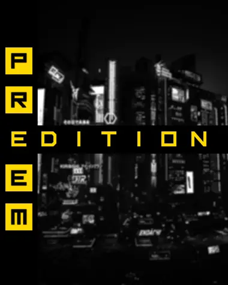

# CHANGELOG // LIVE FEED

> `> SUBSCRIBING TO #changelog-feed...`
> `> AUTO-SYNC: ENABLED`
> `> SOURCE: DISCORD BOT`

This page tracks the current revision of every collection we track. Each
collection's card below always reflects its own **latest** revision, an
update to one collection only replaces that collection's card, the others
stay exactly as they are. Older revisions roll off into the
[Archive](archive.md) as soon as that specific collection updates again.

!!! info "How this page updates"
    Entries are generated from [`template.md`](template.md), which the bot
    fills in and posts here whenever a tracked collection ships a new
    revision. Nothing on this page should be hand-edited except by the bot
    or a staff member performing a manual sync.

!!! tip "Always check this first"
    Before downloading a collection in [Installation](../installation/index.md),
    confirm your game version matches the one shown on its card below.

---

<!-- CHANGELOG:CURRENT:START -->

Preem Edition

<!-- CHANGELOG:CURRENT:ENTRY:buqwx3:START -->
<button type="button" class="pt-changelog-card" data-pt-changelog-open="changelog-current-buqwx3">

Preem Edition-18
2026-11-10 · CP2077 2.31a
Added
Updated
Removed

</button>

<dialog class="pt-changelog-modal" id="changelog-current-buqwx3" markdown="1">

<button type="button" class="pt-changelog-modal-close" data-pt-changelog-close aria-label="Close changelog">×</button>

## Preem Edition-18

Added
Updated
Removed

`2026-11-10` · Game Version `2.31a` · Posted by **Choomba** · Synced from `#CPE`

### Added {: .pt-changelog-h-added }

- [Art Model Poses](https://www.nexusmods.com/cyberpunk2077/mods/19497) (v1.0.1)
- [Assorted Tactical Poses](https://www.nexusmods.com/cyberpunk2077/mods/23006) (v1.0.1)
- [BFF - Couple Pose Pack](https://www.nexusmods.com/cyberpunk2077/mods/17723) (v2.0)
- [BlushEater x Rysyu Warped Tour Pose Pack](https://www.nexusmods.com/cyberpunk2077/mods/20988) (v1.0)
- [Brick Columbarium Fix](https://www.nexusmods.com/cyberpunk2077/mods/28692) (v2.0.1)
- [Contacts Redux - Live Online Status Indicators - Improved Contact List UI - Visible Avatars - Smart Sorting - Phone UI Overhaul](https://www.nexusmods.com/cyberpunk2077/mods/27146) (v2.0.0)
- [Cry X Maddy Mugshot poses](https://www.nexusmods.com/cyberpunk2077/mods/31008) (v1)
- [Dangerous Couples Pose Pack](https://www.nexusmods.com/cyberpunk2077/mods/21822) (v2.0)
- [Freyna Christmas Outfit - Archive XL](https://www.nexusmods.com/cyberpunk2077/mods/26179) (v1.0)
- [Have a seat V poses fem - pm](https://www.nexusmods.com/cyberpunk2077/mods/21421) (v1.0)
- [In The Mood For Love - Couple Pose Pack](https://www.nexusmods.com/cyberpunk2077/mods/10204) (v2.2.2)
- [Lace Dress fem V - ArchiveXL](https://www.nexusmods.com/cyberpunk2077/mods/29151) (v1.0)
- [Look Back - Female Pose Pack](https://www.nexusmods.com/cyberpunk2077/mods/28197) (v1.0)
- [mossglyph_CAM GURL Pose Pack](https://www.nexusmods.com/cyberpunk2077/mods/28771) (v1)
- [mossglyph_MAIN CHARACTER Pose Pack](https://www.nexusmods.com/cyberpunk2077/mods/27203) (v1.0)
- [mossglyph_MIDNIGHT SUN Pose Pack](https://www.nexusmods.com/cyberpunk2077/mods/30191) (v1)
- [NCsVelaris x Watson - Teddy Top FEM V](https://www.nexusmods.com/cyberpunk2077/mods/25707) (v1.1)
- [PMU - Zwei x Rev - Boudoir Set](https://www.nexusmods.com/cyberpunk2077/mods/8053) (v2.31)
- [Ray Traced Lighting Fixes](https://www.nexusmods.com/cyberpunk2077/mods/29720) (v0.5)
- [Rev's Poses - Centerfold](https://www.nexusmods.com/cyberpunk2077/mods/14478) (v2.2a)
- [Ride or Die - Besties Pose Pack](https://www.nexusmods.com/cyberpunk2077/mods/29095) (v1)
- [Sanchez Virtual Boutique - Virtual Atelier](https://www.nexusmods.com/cyberpunk2077/mods/27000) (v1.18)
- [Serene - Female Pose Pack](https://www.nexusmods.com/cyberpunk2077/mods/24430) (v1.0)
- [Smoke and Mirrors - Posepack](https://www.nexusmods.com/cyberpunk2077/mods/24859) (v1.00)
- [Smoking Fem V - PM Pose Set](https://www.nexusmods.com/cyberpunk2077/mods/27578) (v1.0)
- [SOLO Vol.8 pose pack](https://www.nexusmods.com/cyberpunk2077/mods/24029) (v1.0)
- [THE ACTIVEWEAR COLLECTION - AXL CLOTHING](https://www.nexusmods.com/cyberpunk2077/mods/27292) (v2)
- [The Erotic Photography Omnibus - Pose Library](https://www.nexusmods.com/cyberpunk2077/mods/28947) (v1.2)
- [THE RESERVE_Pose Collection](https://www.nexusmods.com/cyberpunk2077/mods/30607) (v1.1)
- [TIRAMISU - SQUARE ONE Solo Pose Collection](https://www.nexusmods.com/cyberpunk2077/mods/26954) (v1)
- [Watson Underground - Atelier](https://www.nexusmods.com/cyberpunk2077/mods/25027) (v1.4)

### Updated

- [Aerix LUT - Photorealism](https://www.nexusmods.com/cyberpunk2077/mods/25836) (v1.4 → v1.4.1)
- [Always Best Quality _ Ads - Map - Hud - Photo Mode - Vending Machines and more](https://www.nexusmods.com/cyberpunk2077/mods/12700) (v4.0.2.31 → v4.1.2.50)
- [AudioXL](https://www.nexusmods.com/cyberpunk2077/mods/33442) (v0.9.2 → v0.9.4)
- [Axellysse Virtual Atelier 2](https://www.nexusmods.com/cyberpunk2077/mods/28924) (v23 → v24)
- [Blue Moon Romanced Quest](https://www.nexusmods.com/cyberpunk2077/mods/32733) (v3.2 → v4.0)
- [Crowd Variety Restored](https://www.nexusmods.com/cyberpunk2077/mods/34908) (v1.0.4 → v1.0.5)
- [DigitalVixen Core](https://www.nexusmods.com/cyberpunk2077/mods/28390) (v4.9.12 → v4.9.13)
- [Essential - Smoke-exe pose pack -PM prop-](https://www.nexusmods.com/cyberpunk2077/mods/28944) (v1.0 → v1.1)
- [Fixed NPC Vehicle Reactions](https://www.nexusmods.com/cyberpunk2077/mods/19530) (v1.0.0 → v1.1.0)
- [Immersive Audio Distance](https://www.nexusmods.com/cyberpunk2077/mods/36809) (v1.2.0 → v1.2.1)
- [Judy Conversations Addon](https://www.nexusmods.com/cyberpunk2077/mods/31463) (v1.0.9 → v1.1.0)
- [Malorian Arms CODA](https://www.nexusmods.com/cyberpunk2077/mods/37487) (v1.0 → v1.1)
- [Mod Settings](https://www.nexusmods.com/cyberpunk2077/mods/4885) (v0.2.28 → v0.2.29)
- [NCPD Cache - New Iconic Weapons](https://www.nexusmods.com/cyberpunk2077/mods/22094) (v1.0.2 → v1.0.3)
- [Night City Traffic Overhaul](https://www.nexusmods.com/cyberpunk2077/mods/25552) (v3.04 → v1.1)
- [Panam Body Enhanced](https://www.nexusmods.com/cyberpunk2077/mods/4843) (v2.2 → v2.21)
- [Panam Conversations Addon](https://www.nexusmods.com/cyberpunk2077/mods/32507) (v1.1.2 → v1.1.3)
- [Projectile Launcher Tweaks](https://www.nexusmods.com/cyberpunk2077/mods/19125) (v1.2.5a → v1.2.5e)
- [Quickhack Fixes](https://www.nexusmods.com/cyberpunk2077/mods/18290) (v1.3.5 → v1.3.6)
- [RedFunctions](https://www.nexusmods.com/cyberpunk2077/mods/32312) (v0.15.1 → v0.16.0)
- [Redscript Configuration Framework](https://www.nexusmods.com/cyberpunk2077/mods/30726) (v3.2.2 → v3.2.3)
- [SneakyBlackCat Boutique](https://www.nexusmods.com/cyberpunk2077/mods/23646) (v13.0 → v14.0)
- [The Nullifier](https://www.nexusmods.com/cyberpunk2077/mods/23091) (v1.4.7 → v1.4.8)
- [Valentino Cyber Arms for Masc and Fem V with support for UV and VTK body mods](https://www.nexusmods.com/cyberpunk2077/mods/15123) (v2.2.0 → v2.2.1)
- [Vehicle Destruction Mesh Fix](https://www.nexusmods.com/cyberpunk2077/mods/35121) (v1.1 → v1.2)

### Removed {: .pt-changelog-h-removed }

- [Axellysse - Cyber Bodysuit 2](https://www.nexusmods.com/cyberpunk2077/mods/29622) (v1)
- [Axellysse - Mili Dress](https://www.nexusmods.com/cyberpunk2077/mods/28795) (v3)
- [Axellysse - Sweet Outfit](https://www.nexusmods.com/cyberpunk2077/mods/29143) (v3)
- [Axellysse - Zipper Swimsuit](https://www.nexusmods.com/cyberpunk2077/mods/26965) (vv1)
- [Cassidy's Holster Shirt - Archive XL](https://www.nexusmods.com/cyberpunk2077/mods/16564) (v2.0)
- [Casual Day Outfit - Archive XL](https://www.nexusmods.com/cyberpunk2077/mods/24351) (v1.1)
- [Casual Style Outfit Pt37](https://www.nexusmods.com/cyberpunk2077/mods/27689) (v1.0)
- [Casual Style Outfit Pt38 - BOTH V](https://www.nexusmods.com/cyberpunk2077/mods/27813) (v1.0)
- [Casual Style Outfit Pt40](https://www.nexusmods.com/cyberpunk2077/mods/34293) (v1)
- [Covergirl Beachwear Archive XL](https://www.nexusmods.com/cyberpunk2077/mods/31389) (v1.0)
- [Cutie Dress](https://www.nexusmods.com/cyberpunk2077/mods/18116) (v1.2)
- [Dancing Night Outfit - Archive XL](https://www.nexusmods.com/cyberpunk2077/mods/27707) (v1.1)
- [Distressed Denim Shorts - ArchiveXL](https://www.nexusmods.com/cyberpunk2077/mods/31817) (v1.0)
- [Essential - LOW SIGNAL pose pack](https://www.nexusmods.com/cyberpunk2077/mods/26493) (v1.0)
- [Essential Vol.2 pose pack](https://www.nexusmods.com/cyberpunk2077/mods/25127) (v1.0)
- [Eve x Ella - Lust and Amour Mega Pose Pack UPDATED for 2.31](https://www.nexusmods.com/cyberpunk2077/mods/17549) (v2.31)
- [Everything - Pose Pack](https://www.nexusmods.com/cyberpunk2077/mods/16451) (v2.2.2)
- [Groovy Y2K Outfit Pt2](https://www.nexusmods.com/cyberpunk2077/mods/28260) (v1.0)
- [infrab's String Bikini](https://www.nexusmods.com/cyberpunk2077/mods/27115) (v1.2.0)
- [Karlee Bikini by HERA - ArchiveXL](https://www.nexusmods.com/cyberpunk2077/mods/29998) (v2)
- [KMKC's 'Sports' Outfit - AXL FemV](https://www.nexusmods.com/cyberpunk2077/mods/31349) (v1)
- [LIONA SWEATER BODYSUIT - AXL CLOTHING](https://www.nexusmods.com/cyberpunk2077/mods/27673) (v2)
- [Nola Dreamer's Fishnet stockings and socks - ARCHIVE XL - Togglable Feet - Equipment-EX](https://www.nexusmods.com/cyberpunk2077/mods/7822) (v1.2)
- [Nola Dreamer's Lingerie Bodysuit - archive XL](https://www.nexusmods.com/cyberpunk2077/mods/19048) (v1.2)
- [PARADISE BIKINI - AXL CLOTHING](https://www.nexusmods.com/cyberpunk2077/mods/20134) (v2)
- [Paul Night Suit - ArchiveXL](https://www.nexusmods.com/cyberpunk2077/mods/28050) (v1.0)
- [PERFORMANCE SPORT SHORT SET - AXL CLOTHING](https://www.nexusmods.com/cyberpunk2077/mods/34660) (v1)
- [Satin Pyjama Set - FemV - AXL](https://www.nexusmods.com/cyberpunk2077/mods/26930) (v1.1)
- [Secretary Dress - Archive XL](https://www.nexusmods.com/cyberpunk2077/mods/19376) (v1.0.2)
- [Shoe Megapack Vol 1 - High Heels](https://www.nexusmods.com/cyberpunk2077/mods/15913) (v1.0)
- [Sport outfit Vol 2 - FEM V Archive XL](https://www.nexusmods.com/cyberpunk2077/mods/18092) (v1.2.1)
- [Sports Leggings Archive XL](https://www.nexusmods.com/cyberpunk2077/mods/4716) (v1.0)
- [Sports Leggings More Colors Archive XL](https://www.nexusmods.com/cyberpunk2077/mods/6904) (v1.0)
- [TIRAMISU - TOP MODEL Pose Pack](https://www.nexusmods.com/cyberpunk2077/mods/20223) (v3.0)
- [Ultimate Hailey Suit Archive XL - ACM - FemV](https://www.nexusmods.com/cyberpunk2077/mods/34197) (v1)

</dialog>
<!-- CHANGELOG:CURRENT:ENTRY:buqwx3:END -->

Subnautica 2 Reborn

<!-- CHANGELOG:CURRENT:ENTRY:9htmlb:START -->
<button type="button" class="pt-changelog-card" data-pt-changelog-open="changelog-current-9htmlb">

Subnautica 2 Reborn-11
2026-09-20 · CP2077 Early Access 1.2
Removed

</button>

<dialog class="pt-changelog-modal" id="changelog-current-9htmlb" markdown="1">

<button type="button" class="pt-changelog-modal-close" data-pt-changelog-close aria-label="Close changelog">×</button>

## Subnautica 2 Reborn-11

Removed

`2026-09-20` · Game Version `Early Access 1.2` · Posted by **Choomba** · Synced from `#9htmlb`

### Removed {: .pt-changelog-h-removed }

- [Scanner Station Range Extender](https://www.nexusmods.com/subnautica2/mods/68) (v1.0.0)

</dialog>
<!-- CHANGELOG:CURRENT:ENTRY:9htmlb:END -->

Expedition 33

<!-- CHANGELOG:CURRENT:ENTRY:jzmqt4:START -->
<button type="button" class="pt-changelog-card" data-pt-changelog-open="changelog-current-jzmqt4">

E33-3
2026-09-06 · CP2077 v1.5.6
Added
Updated

</button>

<dialog class="pt-changelog-modal" id="changelog-current-jzmqt4" markdown="1">

<button type="button" class="pt-changelog-modal-close" data-pt-changelog-close aria-label="Close changelog">×</button>

## E33-3

Added
Updated

`2026-09-06` · Game Version `v1.5.6` · Posted by **Choomba** · Synced from `#jzmqt4`

### Added {: .pt-changelog-h-added }

- [Petank Monster Respawn](https://www.nexusmods.com/clairobscurexpedition33/mods/680) (v1.0)

### Updated

- [Enhanced Descriptions](https://www.nexusmods.com/clairobscurexpedition33/mods/134) (v151.2 → v156.3.5)
- [ForetellVisualBugFixMod](https://www.nexusmods.com/clairobscurexpedition33/mods/645) (v0.1.1 → v0.1.2)
- [Moving Fast Esquie](https://www.nexusmods.com/clairobscurexpedition33/mods/596) (v1.0 → v1.1)
- [Overcharge Unleashed](https://www.nexusmods.com/clairobscurexpedition33/mods/600) (v1.1 → v1.3)
- [UE4SS](https://www.nexusmods.com/clairobscurexpedition33/mods/630) (vUE4SS-v3.0.1-848-g91b70e5 → vUE4SS-V3.0.1-1125-G527a483b)

</dialog>
<!-- CHANGELOG:CURRENT:ENTRY:jzmqt4:END -->

<!-- CHANGELOG:CURRENT:END -->

---

Looking for a specific past release? Head to the [Archive](archive.md).

"Every patch note is a promise. Some of them are even kept." - Preem Team release notes

