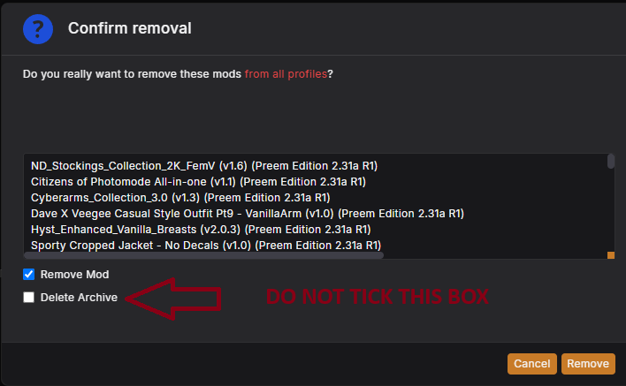
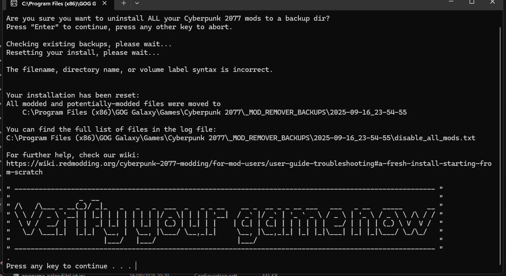
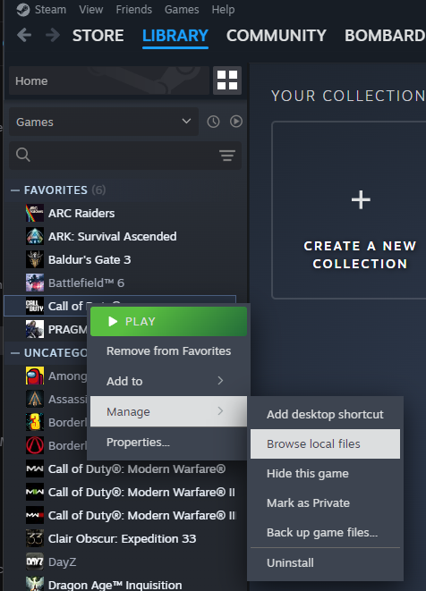
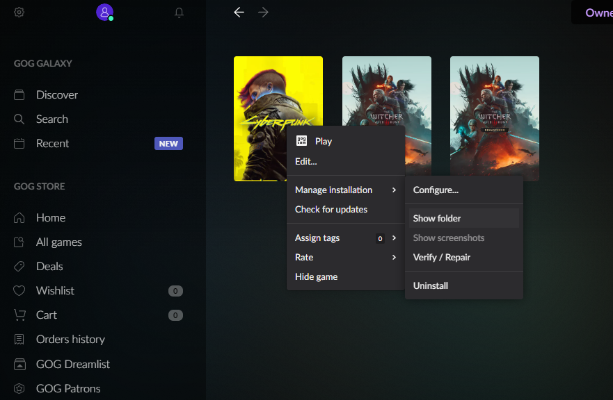
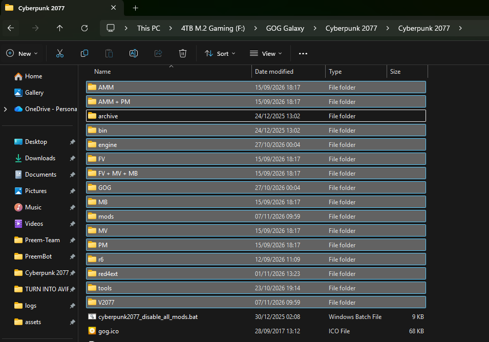
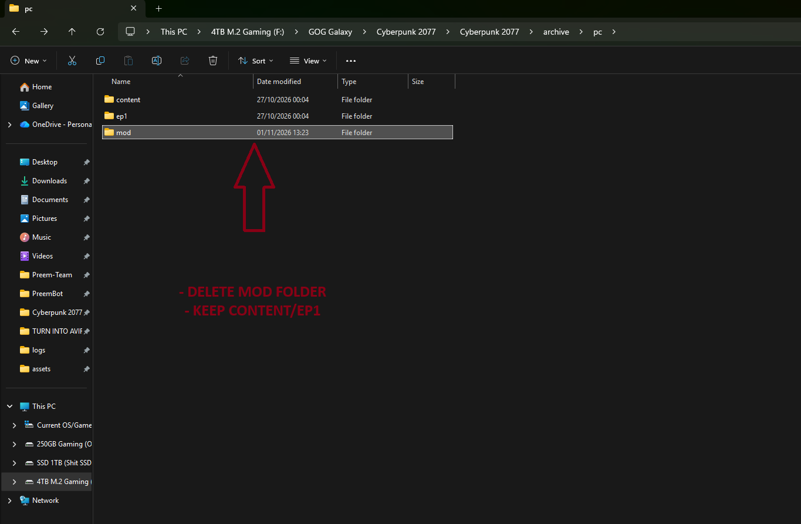
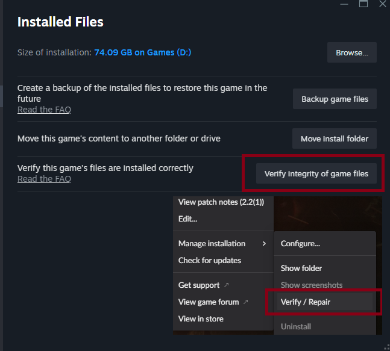

# LET'S GO NUCLEAR // FULL WIPE

> `> ARMING DEVICE...`
> `> TARGET STATE: SCORCHED EARTH / FACTORY FRESH`

the [Clean Install](clean_install.md) guide is a quick fix
that strips out the common traces of modding. Going nuclear is the full wipe,
on top of the Mod Remover run, you'll also delete certain folders inside your
Cyberpunk 2077 install directory by hand so nothing survives.

"Bushido II, bomb’s name was what again?" <cite>— Johnny Silverhand</cite>

!!! info "Who this is for"
    - Anyone whose [Clean Install](clean_install.md) didn't fix
      the problem, was recommended to by the Preem Devs, or who wants an absolutely guaranteed blank slate.

!!! danger "This deletes files"
    Warning: the folders you delete in this guide are permanent.
    Back up anything you want to keep before you start.

## Before you start

- [ ] I've backed up any save files I want to keep
- [ ] I've noted which personal mods I have installed outside the collection
- [ ] I've already tried the [Clean Install](clean_install.md) guide

## Step-by-step wipe

Tick a step off once you've finished it — your progress is saved in this
browser, so it's still here if you close the tab and come back later.

  <input type="checkbox" class="pt-steps-progress-check" data-pt-progress-check disabled aria-hidden="true">
  

    0 / 6 steps complete
    

  

<input type="checkbox" class="pt-step-check" data-pt-step-check aria-label="Mark Step 1 complete">
Step 1: Remove all mods and close Vortex

1. Open up Vortex, and under **Mods** select all the mods (`Ctrl+A`).
2. At the bottom of Vortex select **Remove**, then check **Remove mod** from
   the popup menu — **don't select "Delete Archive"**.

*If `Ctrl+A` doesn't work: select the top mod, scroll to the bottom, hold
`Ctrl` and select the last mod — this will highlight them all.*

You may have to do this multiple times if you still see mods in Vortex.

!!! danger "Force close Vortex"
    Once you've removed all mods, you **must** force close Vortex. Vortex
    **must not** be open or running while you run Mod Remover.

- [ ] All mods removed from Vortex and Vortex fully closed

??? example "📷 Show me"
    { width="500" }

<input type="checkbox" class="pt-step-check" data-pt-step-check aria-label="Mark Step 2 complete">
Step 2: Run Mod Remover

Download [Mod Remover](https://www.nexusmods.com/cyberpunk2077/mods/8597) from
Nexus, extract it into your game's root directory, and run either the `.exe`
or `.bat`. Press Enter to create a backup and let it finish.

When it asks you to verify your game files, **don't do that yet** — we'll do
it after the folder wipe.

- [ ] Ran Mod Remover and let it finish

??? example "📷 Show me"
    { width="500" }

<input type="checkbox" class="pt-step-check" data-pt-step-check aria-label="Mark Step 3 complete">
Step 3: Open your game install folder

Open the folder where Cyberpunk 2077 is installed. The quickest way is
through your game launcher:

=== "Steam"

    Right-click **Cyberpunk 2077** in your Steam Library, then go to
    **Manage → Browse local files**.

    { width="400" }

=== "GOG Galaxy"

    Right-click **Cyberpunk 2077** in GOG Galaxy, then go to
    **Manage installation → Show folder**.

    { width="400" }

!!! tip "Prefer to browse there manually?"
    Open File Explorer and go to where you installed the game. Common default
    locations:

    - **Steam:** `C:\Program Files (x86)\Steam\steamapps\common\Cyberpunk 2077`
    - **GOG:** `C:\GOG Games\Cyberpunk 2077`
    - **Epic:** `C:\Program Files\Epic Games\Cyberpunk2077`

    If you installed to a different drive or library folder, look there
    instead.

- [ ] Game install folder open in File Explorer

<input type="checkbox" class="pt-step-check" data-pt-step-check aria-label="Mark Step 4 complete">
Step 4: Delete everything except the game data

!!! danger "This is permanent"
    Double check you're inside your **Cyberpunk 2077 install folder** before
    deleting anything.

In the game's root folder, delete **every folder except `archive`**. This
includes any leftover mod folders such as `bin`, `engine`, `r6`, `red4ext`,
`tools` and `V2077`, along with anything else you see in there.

Then open `archive` → `pc` and delete everything **except**:

- `content`
- `ep1`

These two folders hold around 90% of the game's data and are never modified
by mods, so there's no need to redownload them. Everything else, including
`archive/pc/mod`, goes.

- [ ] Every folder in the root deleted except `archive`
- [ ] Everything in `archive/pc` deleted except `content` and `ep1`

??? example "📷 Show me"
    The game's root folder — delete everything except `archive`:

    { width="500" }

    Inside `archive/pc` — delete everything except `content` and `ep1`:

    { width="500" }

<input type="checkbox" class="pt-step-check" data-pt-step-check aria-label="Mark Step 5 complete">
Step 5: Verify game files

Now go into Steam/GOG/Epic and verify/repair your game files. This will
redownload every file you just deleted and restore it to stock.

- [ ] Platform verification completed with no unresolved errors

??? example "📷 Show me"
    { width="500" }

<input type="checkbox" class="pt-step-check" data-pt-step-check aria-label="Mark Step 6 complete">
Step 6: Done — some final checks

Congratulations, you now have a factory-fresh Cyberpunk installation.

!!! danger "Do not open Vortex yet"
    First confirm your game boots in a vanilla state, using your default
    launcher (Steam/GOG) — not Vortex.

Once you've confirmed it boots vanilla, re-add the collection from our Nexus
page back into Vortex **under a new profile** (don't reuse your old
profile).

- [ ] Game boots vanilla via Steam/GOG
- [ ] Collection re-added under a new Vortex profile

!!! success "Detonation confirmed"
    You're back to a factory-fresh install. Head back to
    [Installation](../installation/index.md) whenever you're ready to mod again.

!!! failure "Still having issues?"
    Ask in the **Preem Team Discord** or check
    [Troubleshooting](../troubleshooting/index.md).

"Wake the f*** up, Samurai. We have a city to burn." — Johnny Silverhand

